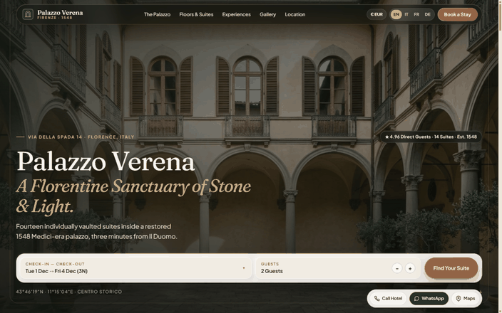
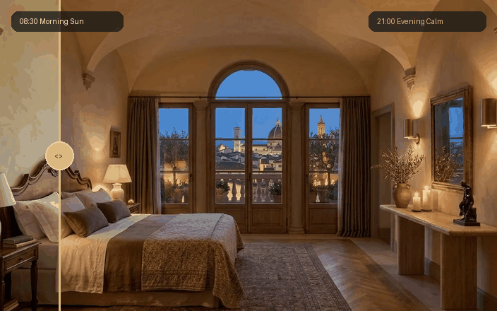
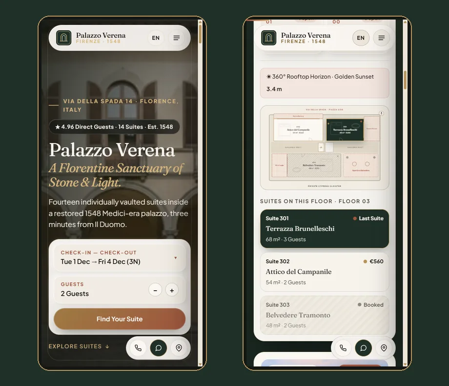

<div align="center">



<br/>

[](https://vercel.com/new/clone?repository-url=https%3A%2F%2Fgithub.com%2FABRUBAB%2Fpalazzo)
[](#performance--engineering)
[](#quick-start)
[](#european-localization--compliance)
[](#european-localization--compliance)

<p align="center">
  <em>14 vaulted suites inside a restored 1548 Medici-era palazzo · Via della Spada 14, 50123 Firenze, Italy</em>
</p>

</div>

---

## Visual Walkthrough

<div align="center">
  
  <br/>
  <sub>Full interactive journey: Cinema Hero → Deep Cypress 4-Floor Explorer → Daylight/Evening Comparer → Live EUR Stay Estimator → Gallery & Florence Map → 3-Step Reservation Confirmation</sub>
</div>

<br/>

### Daylight to Candlelit Evening Study

<div align="center">
  
  <br/>
  <sub>GPU-clipped <code>clip-path</code> slider comparing crisp 08:30 morning daylight against 21:00 brushed-brass sconces &amp; candlelight</sub>
</div>

---

## Key Features & Interactive Craft

### 1. 2-Stage Palazzo Elevation & Architectural Floorplan Explorer
- **4-Story Elevation Switcher**: Interactive Renaissance palazzo facade cutaway highlighting the active story (`03 Rooftop Suites`, `02 Loggia Floor`, `01 Noble Floor`, `00 Garden Cloister`) with dynamic elevator positioning and open-suite counters.
- **14 Interactive SVG Suites (`301`–`003`)**: Custom-drawn architectural CAD floorplans with terraces, travertine soaking tubs, window orientation highlights, door swings, and live availability states (*Available*, *Selected*, *Last Suite*, and *Booked* hatched state with next-open date jump).
- **Amenity Filtering & Synchronized Showcase**: Filter pills (*Private Terrace*, *Soaking Tub*, *Garden View*, *King Bed*) dim non-matching rooms across all stories while keeping clickable suite cards and the 3D-tilted Suite Showcase card synchronized in real time.

### 2. Live EUR Stay Estimator & Custom Date-Range Picker
- **Tactile Calendar Popover**: Supports custom arrival/departure selection plus quick multi-night duration presets (`2 Nights`, `3 Nights (-10%)`, `5 Nights (-15%)`).
- **Real-Time Folio Breakdown (`€`)**: Automatically computes extended-stay privileges (`-10%` for 3–4 nights, `-15%` for 5+ nights), curated neomorphic add-on toggles (*Artisan Courtyard Breakfast*, *Private Florence Airport Chauffeur*, *Evening Tuscan Wine Tasting*, *Late Checkout 2:00 PM*), Florence *Imposta di Soggiorno* (`€5.50 / guest / night`), and transparent 10% Italian IVA.

### 3. 3-Step Slide-Out Direct Reservation Drawer
- **Step 1 — Stay Summary**: Confirms exact floor + blueprint suite, dates, guests, and privileges.
- **Step 2 — Guest Details**: Real-time validation for guest name, email, phone/WhatsApp, arrival window, and GDPR/72h cancellation acceptance.
- **Step 3 — Instant Confirmation**: Generates booking code (`PV-FLR-2026-XXXX`), print-ready summary view, and downloadable `.ics` calendar reservation file.

### 4. European Localization & Compliance
- **Live 4-Language Switcher (`EN | IT | FR | DE`)**: Translates navigation, hero editorial, floor/suite metadata, calculator lines, booking steps, and legal documents without page reload.
- **EU GDPR & Legal Suite**: Granular bottom-docked Cookie Consent banner + Settings modal (persisted in `localStorage`), full **Impressum**, **Privacy Policy (EU 2016/679)**, **Terms of Service**, and floating **Direct Call**, **WhatsApp Concierge**, and **Google Maps** quick actions.

---

## Mobile-First & 5-Tier Responsive Design

<div align="center">
  
</div>

<br/>

| Viewport Tier | Width Target | Verified Layout Highlights |
| :--- | :--- | :--- |
| **Compact Phones** | `360px – 390px` | Single-pill compact language toggle, zero header text collision, horizontal suite cards |
| **Flagship Phones** | `390px – 430px` | `100dvh` safe hero height & `env(safe-area-inset-bottom)` floating action clearance |
| **Tablets & Foldables** | `768px – 1024px` | Full 4-language header bar, 4-column floor deck, 2-column editorial grids |
| **Laptops & Desktop** | `1280px – 1440px` | 2-stage Cypress workbench with sticky Suite Showcase & bottom-left slim GDPR bar |
| **Ultrawide & 4K** | `1920px – 2560px+` | Centered `1440px` architectural grid preventing over-stretching |

---

## Bespoke Architectural Palette ("Florentine Travertine & Brass")

| Token | Hex | Role |
| :--- | :--- | :--- |
| **Warm Travertine Alabaster** | `#F7F3EC` | Primary editorial canvas |
| **Soft Limestone Linen** | `#EDE6DA` | Stay estimator & tactile controls |
| **Tuscan Cypress Olive** | `#1F3028` | Building Explorer stage & active suite states |
| **Obsidian Espresso** | `#1A1715` | Daylight-to-Evening study & footer |
| **Brushed Florentine Brass** | `#B8935A` / `#D9B87E` | Hairlines, metallic shimmer, slider handle |
| **Venetian Terracotta** | `#9E543D` | High-demand tags, eyebrows & Palazzo map pin |

---

## Performance & Engineering

Built in **zero-framework TypeScript + Vite + handcrafted CSS** for instant mobile 4G loading:

- **CSS Bundle**: `53.96 kB` (`12.83 kB` gzipped) — single CSS output (`cssCodeSplit: false`)
- **JS Bundle**: `142.93 kB` (`46.42 kB` gzipped) — includes all 14 suites, 4-language dictionaries, SVG blueprints, state store, calculator, drawer, and modals
- **Self-Hosted Variable Fonts**: `@fontsource-variable/fraunces` & `@fontsource-variable/plus-jakarta-sans` (`font-display: swap`)
- **Optimized Imagery**: **58 responsive `.avif` & `.webp` variants** (`480w`, `960w`, `1440w`) in `public/images/`, strictly **< 175 KB** per file with explicit `width`/`height` dimensions (`CLS = 0.00`)

---

## Project Structure

```text
palazzo/
├── docs/                   # Animated SVG banner, tour GIFs & mobile preview
├── public/
│   ├── images/             # 58 responsive AVIF & WebP photographs (< 175 KB)
│   └── favicon.svg
├── scripts/
│   ├── optimize-images.py  # Pillow responsive 16:10 & 4:5 AVIF/WebP pipeline
│   └── build-readme-media.py
├── src/
│   ├── components/         # Header, Hero, DatePicker, FloorExplorer, Comparer, Calculator, Gallery, Map, Drawer, Overlays
│   ├── data/               # 14 suites/4 floors, EN/IT/FR/DE dictionaries, EU legal docs, Florence landmarks
│   ├── state/              # Reactive store, date availability & EUR pricing engine
│   ├── styles/             # Tokens, base, glass/neu/liquid surfaces, layout, explorer, sections, overlays
│   ├── utils/              # Motion, responsive media skeletons, EUR/ICS formatters
│   └── main.ts
├── index.html
├── vercel.json             # Production headers & rewrites
└── vite.config.ts
```

---

## Quick Start

```bash
# 1. Install dependencies
npm install

# 2. Start development server
npm run dev

# 3. Typecheck & build production bundle
npm run build

# 4. Preview production build locally
npx vite preview --port 4173 --host 127.0.0.1
```

### Deploy to Vercel

Click the **Deploy with Vercel** button at the top of this README or deploy directly via CLI:

```bash
npx vercel --prod
```

---

<div align="center">
  <sub>Designed &amp; Engineered by <strong>Abdulla Rubab</strong> (<a href="https://github.com/ABRUBAB">@ABRUBAB</a>)</sub>
</div>
